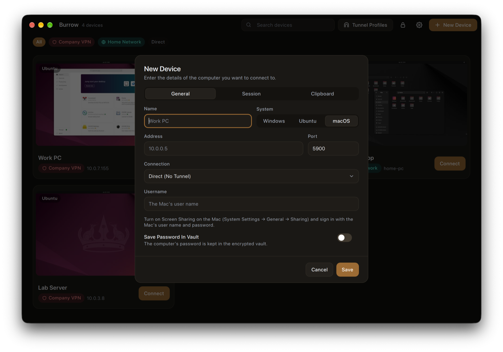
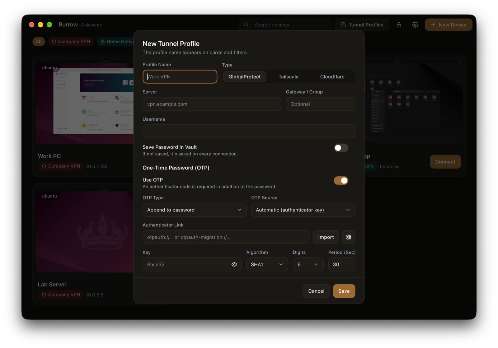

<p align="center">
  <picture>
    <source media="(prefers-color-scheme: dark)" srcset="docs/images/gallery-dark.png">
    
  </picture>
</p>

<h1 align="center">Burrow</h1>

<p align="center">
  <b>Remote desktop through a private tunnel — without touching the rest of your computer.</b><br>
  An open-source remote desktop app for macOS: RDP to Windows and Ubuntu, Screen Sharing to Macs,
  with GlobalProtect, Tailscale and Cloudflare tunnels built in.
</p>

<p align="center">
  <a href="https://github.com/metin-aydin/Burrow/releases/latest"></a>
  <a href="https://github.com/metin-aydin/Burrow/actions/workflows/ci.yml"></a>
  <a href="LICENSE"></a>
  
</p>

> **[Türkçe açıklama aşağıda ↓](#türkçe)**

---

## Why Burrow?

Reaching your work computer usually means switching on a VPN that reroutes *all* of your traffic, then
opening a separate remote desktop app that doesn't always cooperate. Burrow does both in one place:

- **The tunnel lives inside the app.** GlobalProtect (openconnect), Tailscale (tsnet) and Cloudflare Access
  run in userspace, only for Burrow's own connections. Your browser, calls and the rest of the system stay
  on your normal network. No admin rights, no system VPN.
- **One window, every screen.** Each remote monitor opens as a tab; drag a tab onto another display to give
  it its own window, full screen if you like. Burrow remembers the layout per computer.
- **Signs in for you, OTP included.** Import your authenticator QR code once and Burrow types the one-time
  code itself, including two-step portal and gateway flows.
- **Everything stays on your Mac, encrypted.** Computers, passwords, OTP secrets and screen previews live in
  a local vault behind your master password (Argon2id + XChaCha20-Poly1305), with optional Touch ID.
  No cloud, no account.

## Features

| | |
|---|---|
| **Gallery** | Every computer as a card with its last screen, filtered by tunnel, searchable |
| **RDP** (Windows, Ubuntu) | FreeRDP 3 with H.264 (AVC444/AVC420) decoded in hardware, progressive RemoteFX fallback, one remote monitor per Mac display, GNOME Remote Login hand-over, certificate pinning |
| **Macs** (Screen Sharing) | Built-in VNC client speaking Apple's own protocol: Mac user sign-in, encrypted session, the Mac's displays as tabs, Apple's Adaptive picture, the Mac's pointer shapes, Cmd stays Cmd |
| **Tunnels** | GlobalProtect with OTP (TOTP SHA-1/256/512, appended or separate), Tailscale and Headscale with one-button sign-in and device import, Cloudflare Access |
| **Sessions** | Automatic sign-in, lock the remote computer when you disconnect, tabs and windows that remember where you left them |
| **Clipboard & keyboard** | Two-way clipboard (text, rich text, images over RDP), Mac shortcuts translated (Cmd+C → Ctrl+C) or swapped |
| **App** | Light and dark appearance, English and Turkish, menu bar presence with auto-lock |
| **Updates** | Signed and notarized releases; the app updates itself and verifies every download (SHA-256 and the Developer ID team) |

<p align="center">
  
  
</p>

## Install

Download the latest `.dmg` from [Releases](https://github.com/metin-aydin/Burrow/releases/latest) (the
first release is on its way; until then, [build it](#building-macos)), open it and drag **Burrow** to
Applications. Builds are signed with Developer ID and notarized by Apple; later
versions install themselves from inside the app.

Requires macOS 13 or later on Apple silicon. Ubuntu and Windows builds are planned.

To reach a Mac, turn on **System Settings → General → Sharing → Screen Sharing** on it. To reach Ubuntu,
turn on **Remote Desktop** in Settings → System (or Remote Login, where your GNOME offers it).

## Status

Burrow is young and moving fast.

- [x] Encrypted vault, master password, Touch ID
- [x] Embedded RDP sessions: multi-monitor tabs and windows, clipboard, H.264
- [x] GlobalProtect, Tailscale and Cloudflare tunnels inside the app
- [x] Macs over Screen Sharing (VNC), with their displays as tabs
- [x] Signed releases and in-app updates
- [ ] `burrow-agent` for Ubuntu: unlock on connect, lock on disconnect, turn the office monitor off
- [ ] Clipboard for Macs (Apple's pasteboard protocol)
- [ ] Ubuntu and Windows builds

Requirements: [docs/SPEC.md](docs/SPEC.md) · Architecture decisions: [docs/decisions](docs/decisions)

## Security

- Secrets never leave the encrypted vault; they are not written to logs or test fixtures.
- RDP servers are pinned on first use and Burrow refuses to connect if the certificate changes.
- A wrong password is never retried automatically, so an account is not locked out.
- Updates come only over HTTPS from this repository's releases, and are installed only if the archive
  matches its SHA-256 and the new app is signed by the same Apple developer team.

Found a vulnerability? Please report it privately — see [SECURITY.md](SECURITY.md).

## Architecture

```
┌──────────────────── Burrow.app ────────────────────┐
│  QML UI  ──  AppController (C++)                   │
│                │                  │                │
│     RDP: FreeRDP 3      VNC: own RFB client        │
│     (H.264 via          (Apple 003.889, Adaptive)  │
│      VideoToolbox)                │                │
│                └───────┬──────────┘                │
│        netcore (Go, linked as a C archive)         │
│        ├─ libopenconnect ... GlobalProtect         │
│        ├─ tsnet ............ Tailscale             │
│        ├─ Cloudflare Access (WebSocket)            │
│        └─ encrypted vault, TOTP                    │
└────────────────────────────────────────────────────┘
```

Qt 6 (QML + C++20) · FreeRDP 3 · Go · see [ADR 0001](docs/decisions/0001-tech-stack.md)

## Building (macOS)

```bash
brew install go cmake ninja qt freerdp openconnect
cmake -S . -B build -G Ninja -DCMAKE_PREFIX_PATH="$(brew --prefix qt);$(brew --prefix freerdp)"
cmake --build build
open build/app/Burrow.app
```

Tests: `cd build && ctest` (C++) · `cd netcore && go test ./...` (Go)

Try the interface with sample computers, in a throwaway vault:

```bash
BURROW_VAULT=/tmp/burrow-demo/vault.json build/app/Burrow.app/Contents/MacOS/Burrow --seed-demo
```

## Project layout

- `app/` — the Qt app: QML interface (`qml/`), controller, RDP and VNC sessions, vault wrapper
- `netcore/` — Go network core: tunnels, TOTP, encrypted vault
- `docs/` — requirements, architecture decisions (ADR), research, project memory
- `.github/` — CI and automated releases (`development` → `master`)

## Contributing

Issues and pull requests are welcome. Please read [CLAUDE.md](CLAUDE.md) first: it holds the project rules
for people and AI assistants alike. Commits follow [Conventional Commits](https://www.conventionalcommits.org/);
version numbers are derived from them.

## License

[MIT](LICENSE). Third-party components keep their own licenses: FreeRDP (Apache-2.0), Qt (LGPL-3.0),
libopenconnect (LGPL-2.1), Tailscale (BSD-3-Clause). Burrow's Mac support builds on the Apple Screen
Sharing research of [zDesk](https://github.com/andrewtheguy/zdesk) (MIT); see
[THIRD_PARTY_NOTICES.md](THIRD_PARTY_NOTICES.md). Sample previews are GPL-licensed Ubuntu screenshots from
Wikimedia Commons ([attribution](docs/assets/demo/ATTRIBUTION.md)).

---

## Türkçe

**Burrow**, iş veya ev bilgisayarına uzak masaüstüyle bağlanmanı sağlayan açık kaynak bir macOS
uygulamasıdır. Windows ve Ubuntu'ya RDP ile, Mac'lere Ekran Paylaşımı ile bağlanır. GlobalProtect,
Tailscale ve Cloudflare tünellerini **yalnızca uygulamanın içinde** açar: bilgisayarının geri kalan trafiği
etkilenmez, yönetici yetkisi gerekmez.

- **Tek pencere, bütün ekranlar:** her uzak monitör bir sekme; sekmeyi başka bir ekrana sürükleyip ayrı
  pencere yapabilirsin, Burrow düzeni bilgisayar başına hatırlar.
- **Otomatik OTP:** authenticator QR kodunu bir kez içe aktar, tek kullanımlık kodu Burrow girer.
- **Şifreli yerel kasa:** cihazlar, şifreler, OTP anahtarları ve önizlemeler ana şifrenle şifrelenip yalnızca
  bu Mac'te saklanır; Touch ID ile açılabilir.
- **Mac'ler:** Ekran Paylaşımı ile, Mac kullanıcı adınla; Mac'in ekranları sekme olarak gelir.
- **Güncellemeler:** imzalı ve Apple onaylı sürümler; uygulama kendini günceller ve her indirmeyi doğrular.

Kurulum: [Releases](https://github.com/metin-aydin/Burrow/releases/latest) sayfasından `.dmg` dosyasını indir.
Gereksinimler [docs/SPEC.md](docs/SPEC.md), kararlar [docs/decisions](docs/decisions) altında. Proje
kuralları ve hafızası: [CLAUDE.md](CLAUDE.md), [docs/memory](docs/memory).
