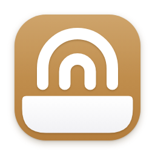
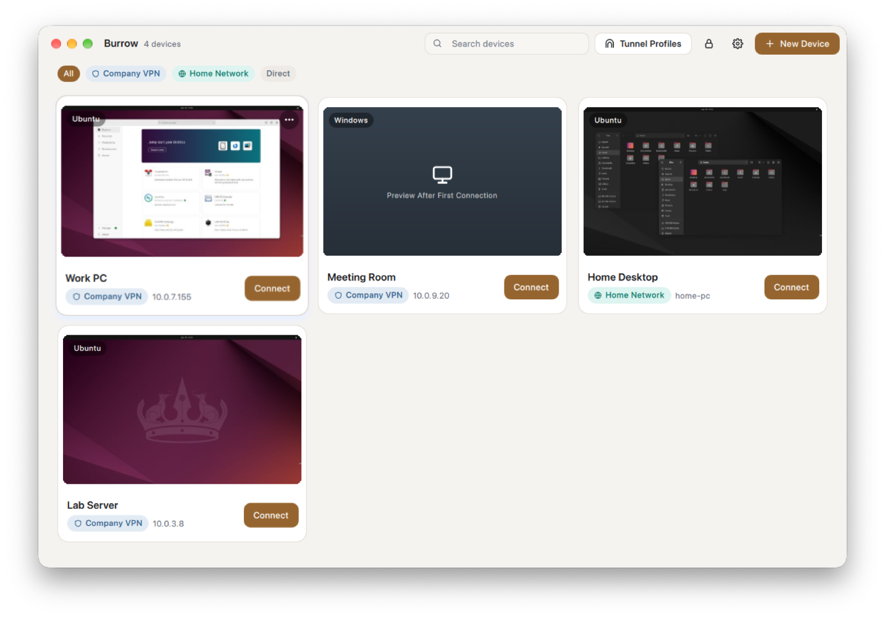
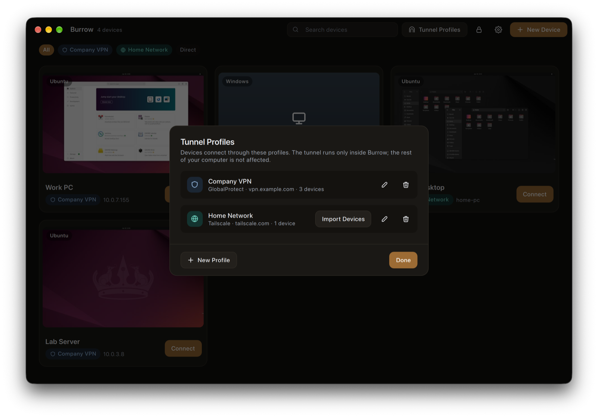
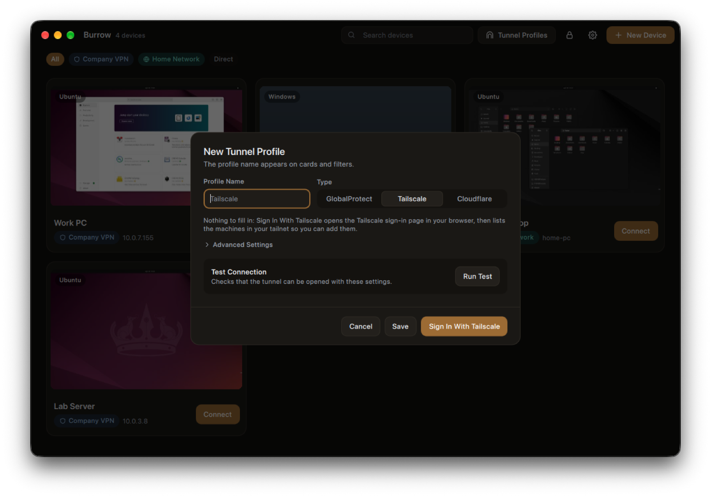
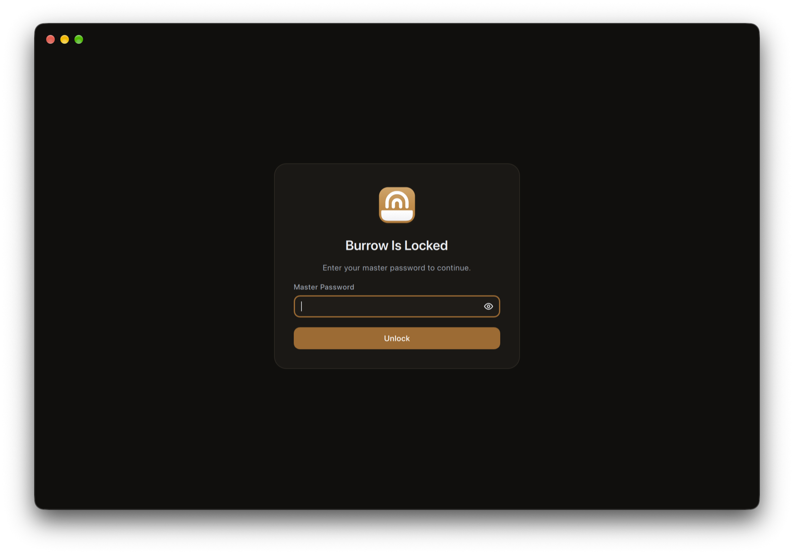
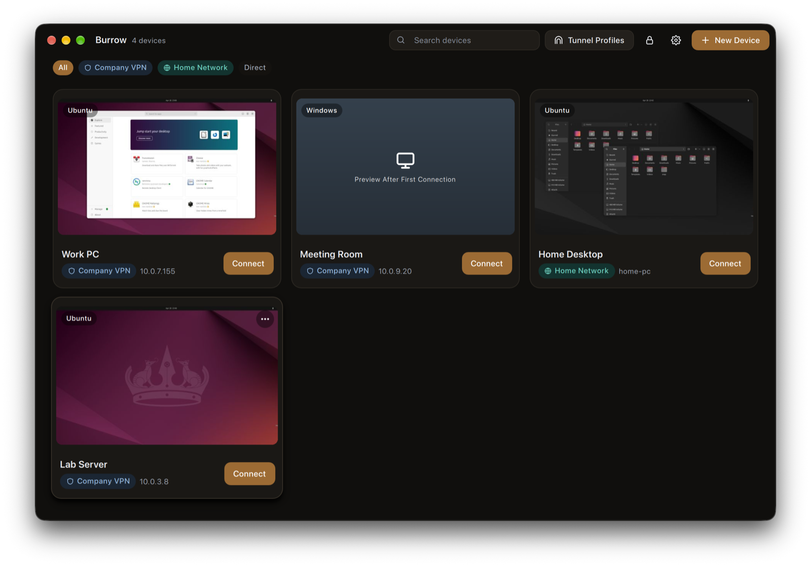
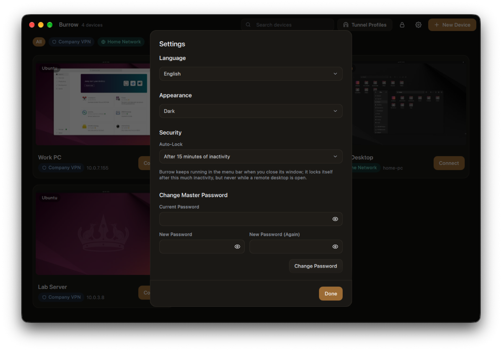

<p align="center">
  
</p>

<h1 align="center">Burrow</h1>

<p align="center">
  A cross-platform, open-source remote desktop app with <strong>private tunnels built in</strong>:
  RDP to Windows and Ubuntu, Screen Sharing to Macs. Available for macOS, Windows and Ubuntu.
</p>

<p align="center">
  <a href="https://github.com/metin-aydin/Burrow/actions/workflows/ci.yml"></a>
  <a href="LICENSE"></a>
</p>

Burrow puts every computer you reach into one gallery, each card showing its last screen. It connects to Windows and
Ubuntu over RDP and to Macs over Screen Sharing, and it opens the **GlobalProtect, Tailscale or Cloudflare tunnel**
those computers sit behind by itself, inside the app only: your browser, calls and the rest of the system stay on your
normal network. Remote monitors open as tabs that you can drag onto your own displays, one-time codes are typed for
you, and every secret stays in an encrypted vault on your own computer.

> Burrow is an independent project and is not affiliated with Palo Alto Networks, Tailscale, Cloudflare or Apple.

<p align="center">
  <picture>
    <source media="(prefers-color-scheme: dark)" srcset="docs/images/gallery-dark.png">
    
  </picture>
</p>

## Tunnels inside the app

Reaching a work computer usually means switching on a VPN that reroutes all of your traffic, then opening a separate
remote desktop app. Burrow opens the tunnel itself, only for its own connections.


- **Nothing changes on your system.** GlobalProtect (openconnect), Tailscale (tsnet) and Cloudflare Access run in
  userspace inside Burrow. There is no system VPN, no network extension and no admin password.
- **GlobalProtect with one-time codes.** Import your authenticator's QR code or `otpauth://` link once and Burrow types
  the code for you, appended to the password or in a separate step, including two-step portal and gateway flows.
- **Tailscale and Headscale.** Sign in with one button in your browser, then pick the machines in your tailnet to add
  them as devices.
- **Cloudflare Access.** Reach computers published with cloudflared; you sign in once in the browser and the token is
  kept in the vault.
- **Tunnels follow your devices.** Each device picks its tunnel profile; connecting to it opens the tunnel, and the
  gallery shows which tunnels are up.
- **A test before you save.** Each profile can be tested on the spot; a rejected login is never retried, so your
  account is not locked out.

| | |
| --- | --- |
|  |  |
| **Tunnel profiles** with their type, server and how many devices use them. | **Tailscale**: nothing to fill in; sign in, then import machines from your tailnet. |

**Security.** Computers, passwords, OTP keys and screen previews live in a local vault encrypted with your master
password (Argon2id and XChaCha20-Poly1305). Nothing is sent to a cloud
service and there is no account. RDP servers are pinned on first use and Burrow refuses to connect if the certificate
changes. Secrets are never written to logs. To report a vulnerability, see [SECURITY.md](SECURITY.md).

## Features

- **Gallery** of every computer as a card with its last screen, filtered by tunnel and searchable.
- **RDP to Windows and Ubuntu** with FreeRDP 3: H.264 (AVC444/AVC420) decoded in hardware where the system offers it, progressive RemoteFX as a
  fallback, GNOME Remote Login hand-over and certificate pinning.
- **Screen Sharing to Macs** with a built-in VNC client that speaks Apple's protocol: sign in with the Mac's user,
  encrypted session, the Mac's displays as tabs, Adaptive picture quality and the Mac's own pointer shapes.
- **Multi-monitor**: one remote monitor per tab; drag a tab onto another display to give it its own window, full
  screen if you like. Burrow remembers the layout for each computer.
- **Tunnels**: GlobalProtect with OTP (TOTP SHA-1/256/512), Tailscale and Headscale, Cloudflare Access. See
  [Tunnels inside the app](#tunnels-inside-the-app).
- **Sessions**: automatic sign-in and an option to lock the remote computer when you disconnect.
- **Clipboard and keyboard**: two-way clipboard over RDP (text, rich text, images and files); on a Mac,
  shortcuts translated (Cmd+C → Ctrl+C) or swapped.
- **Encrypted local vault** with a master password and auto-lock after inactivity; Burrow keeps
  running in the menu bar or system tray when its window is closed.
- **In-app updates** from GitHub Releases on macOS and Windows, verified by SHA-256 and, on macOS, the Developer ID
  team before they are installed.
- English and Turkish interface, light and dark themes, screen reader labels (VoiceOver, Narrator) and keyboard
  navigation.

## Screenshots

| | |
| --- | --- |
|  |  |
| **Lock screen**: the vault opens with your master password. | **Gallery** in the dark theme, with each computer's tunnel and address. |
|  |  |
| **New device**: Windows, Ubuntu or a Mac, with its address, tunnel and user. | **GlobalProtect** with one-time codes from your authenticator. |
|  |  |
| **Settings**: language, appearance, auto-lock, master password and updates. | **Tunnel profiles**, tested and used by your devices. |

Screenshots are taken from the built app with sample data by `tools/readme-shots.sh`.

## Download

Get the latest version from the [Releases](https://github.com/metin-aydin/Burrow/releases/latest) page.

| Platform | File | Updates |
| --- | --- | --- |
| macOS 13 or later (Apple Silicon) | `Burrow-<version>-mac-arm64.dmg` | In the app |
| Ubuntu 24.04 or later (x86-64), early build | `Burrow-<version>-linux-x64.AppImage` | From the Releases page |
| Windows 10 or later (x86-64), early build | `Burrow-<version>-windows-x64-setup.exe` (or `-portable.zip`) | In the app (installer only) |

On macOS, open the `.dmg` and drag **Burrow** to Applications. The app is signed with Developer ID and notarized
by Apple.

On Ubuntu, make the AppImage executable and run it:

```bash
chmod +x Burrow-*-linux-x64.AppImage
./Burrow-*-linux-x64.AppImage
```

If it does not start, install FUSE 2 (`sudo apt install libfuse2t64`). The Linux build does not update itself yet.

On Windows, run the setup file: it installs Burrow for your user only (no administrator rights) and adds Start menu
and desktop shortcuts. The Windows build is not code-signed yet, so SmartScreen may warn about an unknown publisher:
choose **More info → Run anyway**. The portable zip runs from any folder but does not update itself.

To reach a Mac, turn on **System Settings → General → Sharing → Screen Sharing** on it. To reach Ubuntu, turn on
**Remote Desktop** in **Settings → System** (or Remote Login, where your GNOME offers it).

On macOS and Windows (installed), Burrow looks for a new version 15 seconds after startup and every six hours. When it finds one, **Settings → Updates**
downloads it, installs it and restarts the app. Nothing is downloaded or installed without asking, and automatic
checks can be turned off there.

## Development

Burrow is written in Qt 6 (QML and C++20) with FreeRDP 3 and a Go network core linked as a C archive
([ADR 0001](docs/decisions/0001-tech-stack.md)). On macOS the requirements are Homebrew and the Xcode
command line tools; Windows builds are described below.

```bash
git clone https://github.com/metin-aydin/Burrow.git
cd Burrow
brew install go cmake ninja qt freerdp openconnect
cmake -S . -B build -G Ninja -DCMAKE_PREFIX_PATH="$(brew --prefix qt);$(brew --prefix freerdp)"
cmake --build build
open build/app/Burrow.app
```

On Windows, install [MSYS2](https://www.msys2.org) and [Go](https://go.dev/dl/), then in an **MSYS2 UCRT64** shell
([ADR 0010](docs/decisions/0010-windows-port.md); the script also builds libopenconnect, which no Windows package has):

```bash
tools/windows-deps.sh C:/burrow-deps
export PKG_CONFIG_PATH=/c/burrow-deps/lib/pkgconfig
cmake -S . -B build -G Ninja
cmake --build build
PATH="/c/burrow-deps/bin:$PATH" build/app/Burrow.exe
```

Try the interface with sample computers in a throwaway vault:

```bash
BURROW_VAULT=/tmp/burrow-demo/vault.json build/app/Burrow.app/Contents/MacOS/Burrow --seed-demo
```

Checks:

```bash
(cd build && ctest --output-on-failure)   # C++ tests
(cd netcore && go test ./...)             # Go tests
cmake --build build --target Burrow_lupdate && git diff --exit-code -- app/i18n   # translations are up to date
```

Requirements are in [docs/SPEC.md](docs/SPEC.md) and architecture decisions in [docs/decisions](docs/decisions).

## Branches and releases

- Work happens on `development`. `master` only changes through pull requests from `development`.
- Each merge into `master` publishes a release. The [Release workflow](.github/workflows/release.yml) picks the
  version, builds and signs the macOS package and attaches it to a new GitHub release, which the in-app updater then
  offers to users. If any build fails, the draft release is deleted.
- The description of that pull request becomes the release notes (see the
  [pull request template](.github/pull_request_template.md)).
- Versions come from [Conventional Commits](https://www.conventionalcommits.org/) since the previous release: `feat:`
  raises the minor number, a breaking change (`feat!:` or `BREAKING CHANGE:`) the major number, anything else the
  patch number ([ADR 0002](docs/decisions/0002-release-and-auto-update.md)).

## Packaging

```bash
cmake -S . -B build -G Ninja -DCMAKE_BUILD_TYPE=Release \
  -DCMAKE_PREFIX_PATH="$(brew --prefix qt);$(brew --prefix freerdp)"
cmake --build build
"$(brew --prefix qt)/bin/macdeployqt" build/app/Burrow.app -qmldir=app/qml   # bundle Qt, QML and libraries
```

Release builds of the macOS app are signed with a Developer ID certificate and notarized by Apple. The Release
workflow reads these secrets from the `release` environment: `CSC_LINK` (the base64-encoded `.p12` certificate),
`CSC_KEY_PASSWORD`, `APPLE_ID`, `APPLE_APP_SPECIFIC_PASSWORD` and `APPLE_TEAM_ID`. Without them the release stops,
and local builds are left unsigned.

## Issues and contributions

Bug reports and feature requests are welcome on [GitHub Issues](https://github.com/metin-aydin/Burrow/issues).
Pull requests go to the `development` branch, with commit messages in Conventional Commits format.
User-facing text is written in English in the source and translated in `app/i18n/burrow_tr.ts`; run the
`Burrow_lupdate` target before opening a pull request. [CLAUDE.md](CLAUDE.md) holds the project rules for people and AI
assistants alike.

## License

[MIT](LICENSE). Third-party components keep their own licenses: FreeRDP (Apache-2.0), Qt (LGPL-3.0), libopenconnect
(LGPL-2.1) and Tailscale (BSD-3-Clause). Mac support builds on the Apple Screen Sharing research of
[zDesk](https://github.com/andrewtheguy/zdesk) (MIT); see [THIRD_PARTY_NOTICES.md](THIRD_PARTY_NOTICES.md). Sample
previews are GPL-licensed Ubuntu screenshots from Wikimedia Commons ([attribution](docs/assets/demo/ATTRIBUTION.md)).
