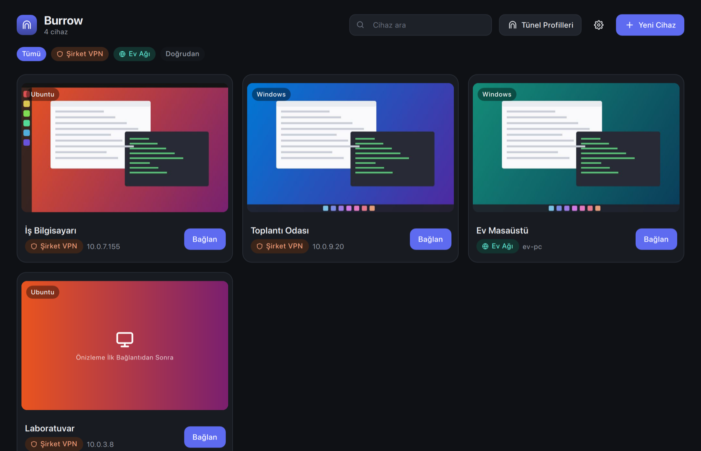

<p align="center">
  
</p>

<h1 align="center">Burrow</h1>

<p align="center">
  <b>Remote desktop through a private tunnel — without touching the rest of your computer.</b><br>
  An open-source RDP client for macOS, Ubuntu and Windows with built-in GlobalProtect and Tailscale tunnels.
</p>

<p align="center">
  <a href="LICENSE"></a>
  
  
</p>

> **[Türkçe açıklama aşağıda ↓](#türkçe)**

---

## Why Burrow?

Connecting to your work PC usually means turning on a full VPN that reroutes *all* of your traffic,
then opening a separate RDP app that doesn't always cooperate. Burrow does both in one place:

- **The tunnel lives inside the app.** GlobalProtect (via openconnect) or Tailscale (via tsnet) runs in
  userspace. Only Burrow's RDP traffic goes through it — your browser, music and the rest of the system
  stay on your normal network. No admin rights, no system VPN.
- **Built-in RDP client.** The remote desktop renders in Burrow's own windows (FreeRDP 3), with
  multi-monitor support as tabs or detachable windows that remember their layout per device.
- **One-tap login, even with OTP.** Import your authenticator QR (`otpauth://` or Google Authenticator
  export) and Burrow fills the one-time code for you — including double-OTP portal/gateway flows.
- **Everything encrypted, everything local.** Devices, passwords, OTP secrets and screen previews live in
  a local vault protected by your master password (Argon2id + XChaCha20-Poly1305), optionally unlocked
  with Touch ID. No cloud, no account.

## Features

| | |
|---|---|
| **Device gallery** | Cards with each computer's last screen as a preview, filter by tunnel, search |
| **Tunnels** | GlobalProtect (auth group, split-DNS safe, TOTP with SHA1/256/512), Tailscale / Headscale |
| **Sessions** | Auto-login, lock on disconnect, sign out or keep session, existing vs. new session (Ubuntu) |
| **Clipboard** | Two-way text, rich text and images |
| **Mac keyboard** | Cmd+C → Ctrl+C shortcut translation, full Cmd ↔ Ctrl swap, or off |
| **Updates** | Automatic updates from GitHub Releases (Sparkle), signed and notarized |

<p align="center">
  
</p>

## Status

Burrow is in **early development** — not ready for daily use yet.

- [x] Encrypted vault, master password, Touch ID (signed builds)
- [x] Device gallery, device and tunnel profile editors, TOTP import with live code
- [x] GlobalProtect userspace tunnel verified against a real gateway (prototype)
- [ ] Embedded RDP session (FreeRDP) with multi-monitor and clipboard
- [ ] Tailscale (tsnet) and GlobalProtect (libopenconnect) inside the app
- [ ] `burrow-agent` for Ubuntu: unlock on connect, lock on disconnect
- [ ] Signed releases and auto-update

Roadmap and requirements: [docs/SPEC.md](docs/SPEC.md) · Architecture decisions: [docs/decisions](docs/decisions)

## Architecture

```
┌──────────────── Burrow.app ────────────────┐
│  QML UI  ──  AppController (C++)           │
│               │             │              │
│        FreeRDP 3 engine   Vault (Go)       │
│               │                            │
│        netcore (Go, linked as C archive)   │
│        ├─ tsnet ............ Tailscale     │
│        ├─ libopenconnect ... GlobalProtect │
│        └─ gVisor netstack (userspace TCP)  │
└────────────────────────────────────────────┘
```

Qt 6 (QML + C++20) · FreeRDP 3 · Go netcore · see [ADR 0001](docs/decisions/0001-tech-stack.md)

## Building (macOS)

```bash
brew install go cmake ninja qt freerdp
cmake -S . -B build -G Ninja -DCMAKE_PREFIX_PATH="$(brew --prefix qt);$(brew --prefix freerdp)"
cmake --build build
open build/app/Burrow.app
```

Tests: `cd build && ctest` (C++) · `cd netcore && go test ./...` (Go)

Try the UI with sample devices (uses a throwaway vault):

```bash
BURROW_VAULT=/tmp/burrow-demo/vault.json build/app/Burrow.app/Contents/MacOS/Burrow --seed-demo
```

## Project layout

- `app/` — Qt 6 app: QML UI (`qml/`), C++ controller, vault wrapper, RDP engine
- `netcore/` — Go network core: tunnels, loopback forwarding, TOTP, encrypted vault
- `docs/` — requirements, architecture decisions (ADR), research, project memory
- `tools/` — prototypes and diagnostics
- `.github/` — CI and automated releases (`development` → `master`)

## Contributing

Issues and pull requests are welcome. Please read [CLAUDE.md](CLAUDE.md) first — it holds the project
rules (for humans and AI assistants alike). Commits follow
[Conventional Commits](https://www.conventionalcommits.org/); versions are derived from them.

## License

[MIT](LICENSE). Third-party components keep their own licenses: FreeRDP (Apache-2.0),
Qt (LGPL-3.0), libopenconnect (LGPL-2.1), Tailscale (BSD-3-Clause).

---

## Türkçe

**Burrow**, iş veya ev bilgisayarına uzak masaüstü (RDP) ile bağlanmanı sağlayan açık kaynak bir
uygulamadır. GlobalProtect VPN'ini veya Tailscale'i **yalnızca uygulamanın içinde** açar: bilgisayarının
geri kalan trafiği etkilenmez, yönetici yetkisi gerekmez.

- **Kart galerisi:** her bilgisayar son ekran görüntüsüyle bir kart olarak görünür.
- **Otomatik OTP:** authenticator QR kodunu bir kez içe aktar; tek kullanımlık kodu Burrow girer
  (çift OTP'li portal/gateway akışları dahil).
- **Şifreli yerel kasa:** cihazlar, şifreler, OTP anahtarları ve önizlemeler ana şifrenle şifrelenip yalnızca
  bu bilgisayarda saklanır; Touch ID ile açılabilir.
- **Çoklu monitör, çift yönlü pano, Mac kısayol çevirisi** (Cmd+C → Ctrl+C).

Durum: erken geliştirme aşamasında. Gereksinimler [docs/SPEC.md](docs/SPEC.md), kararlar
[docs/decisions](docs/decisions) altında. Proje kuralları ve hafızası: [CLAUDE.md](CLAUDE.md),
[docs/memory](docs/memory).
